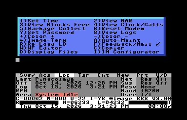

:toc: left

== Boot Up

include::includes/boot-command.adoc[]

=== Startup Files

=== Idle Screen Display

==== Idle Screen Keys [[idle-keys]]

At the idle screen, while the BBS waits for a call, keys at the console run sysop functions.
kbd:[?], or any key that isn't one of them, shows this menu of them:

.The idle screen's key menu

The function keys kbd:[f1]-kbd:[f8] work the lightbar as always (see <<lightbar>>), and kbd:[Space] redraws the idle screen.

[%autowidth]
[%header]
|===
| Key | Function | What it does

| kbd:[1] | Set Time | Sets the BBS clock: from the clock source, or by hand (see <<set-the-clock>> and <<im-set-time>>)
| kbd:[2] | View BAR | Shows the board activity register in the top of the screen
| kbd:[3] | View Blocks Free | Shows the blocks free on the six Image drives in the top of the screen
| kbd:[4] | View Clock/Calls | Shows the feedback, sysop mail, calls (or, with the `Alt` right lightbar check, new messages) and new users counts, and the last ten callers, in the top of the screen
| kbd:[5] | Garbage Collect | Tidies up BASIC`'s string memory
| kbd:[6] | Reset Modem | Initializes the modem again (logged as "`modem reset`")
| kbd:[7] | Set Password | A system password callers must give on kbd:[A]ll calls, kbd:[O]ne call, or kbd:[N]one; the screen shows it as `Resv`
| kbd:[8] | View Logs | Shows a day's kbd:[A]ctivity, kbd:[I]dle or kbd:[N]et log
| kbd:[+], kbd:[-] | Color +, Color - | Changes the default text output color, 1 to 15 in turn, which is saved to `e.data`. The clock redraws in the current color.
| kbd:[←] | Image-Term | Loads Image-Term, the terminal program
| kbd:[A] | Auto-Maint | Runs AutoMaintenance now
| kbd:[R] | Re-Load LO | Loads `i.lo`, the idle and logon module, again
| kbd:[F] | Feedback/Mail&#160;✓ | Shorthand for `"Check feedback and mail"`&#8212;reads the feedback and the sysop`'s mail
| kbd:[W] | WF Editor | Logs on locally as the sysop (user 1), straight into the WF file editor (see <<text-editor>>)
| kbd:[C] | Copier | Takes the phone off the hook (`ATH1`), then loads the file copier
| kbd:[D] | Display Files | Takes the phone off the hook, then reads files on disk (`RF`)
| kbd:[I] | IM Configurator | Takes the phone off the hook, then goes into `IM` in pseudo-local mode (see <<im-configuration>>)
|===

Two keys aren`'t on the menu:

[%autowidth]
|===
| kbd:[T] | Inverts the modem's carrier detect signal, as the `DCD` left lightbar check does (see <<status-line>>)
| kbd:[£] | Answers the phone now (`ATA`)
|===

TIP: kbd:[T] changes the setting only until the BBS restarts, which sets the lightbar's checks from `e.lightdefs`.
To keep it, set the `DCD` left check the same way in the Configuration Editor's <<im-lightbar,Lightbar/Alarms>>, kbd:[A] LightBar Defs (see <<lightbar-defaults>>), and save the table.

===== Your Own Idle Commands

You can add keys of your own, which run `i/lo.` modules; they`'re listed in the menu after the others.
They're kept in `e.idle cmds` on the Etcetera drive, and edited with `i.edit idlecmds` (_Edit Idle Commands_): kbd:[L]ist, kbd:[E]dit (an item's number) and kbd:[Q]uit.
Each command has:

[%autowidth]
|===
| _Keypress_ | The key that runs it
| _LM Value_ | A number passed to the module in `lm`, so one module can do several things
| _Filename_ | The module to run, `i/lo.` _name_
| _Text_ | What the menu shows, up to 16 characters
|===

=== Status Line

==== Status Indicators [[boot-up-status-indicators]]

.Function Indicators
[options="autowidth",options="header"]
|====================
| Character | Purpose
| `A` | Text output aborted
| `G` | Garbage collection occurring
| `I` | Interrupt occurring
| `L` | Loading data
| `P` | Text output paused
| `S` | Swapping data between RAM and ROM
|====================

// L is also documented in &,13: arbit (Lt. Kernal port arbitration), miscl.s
// Port locking?

// TODO: More of an explanation.

.File transfer indicators
[options="autowidth",options="header"]
|====================
| Character | Purpose
| `F` | RS232 flow control asserted 
| `O` | Overrun
|====================

// TODO: Move to file transfer section?
